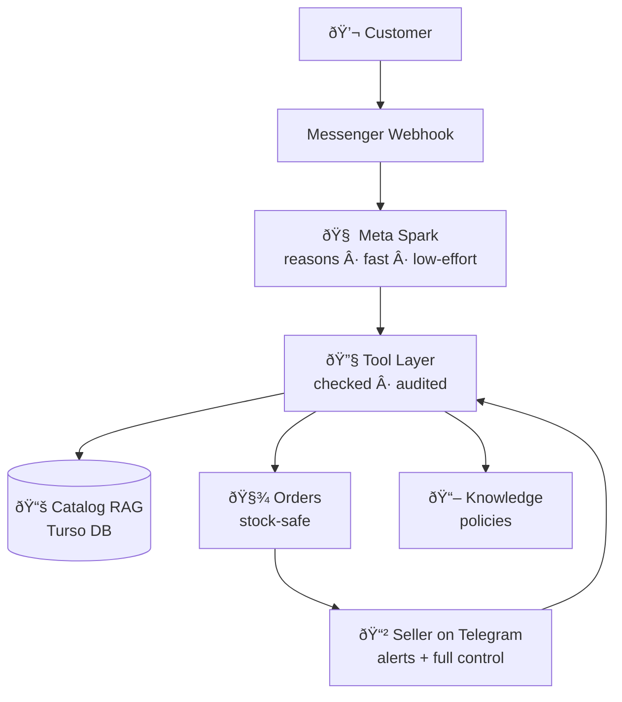

<div align="center">

# 🛍️ AI Commerce Agent

### *Not a chatbot. An AI employee for your shop.*

Customers chat in **English · Bangla · Banglish** → the agent understands, searches the real catalog, sends product photos, takes orders without overselling, and pings the seller on Telegram. **The seller runs the whole business from Telegram.**

[](https://ai.meta.com)
[](https://developers.facebook.com/docs/messenger-platform)
[](https://python.org)

[](#-tests)


</div>

---

## 🎬 The 60-Second Demo

| Step | What happens |
|---|---|
| 💬 *"do you have saree?"* | Real sarees, real prices — `4,200৳`, never invented |
| 📸 *"Banarasi saree ta dekha jabe?"* | The **actual product photo** arrives in chat |
| 🧠 *"can you show a picture?"* | It knows which product you mean — even on a fresh server |
| 🧾 Order → review summary → **confirm** | No order exists until the customer says yes |
| 📲 Seller's Telegram lights up | Order details, sales, hot leads, one tap away |

---

## ⚔️ Why It's Different

<div align="center">

| 🤖 Standard Messenger Bot | 🚀 This Agent |
|---|---|
| Keyword rules, one LLM call | **Tool-based agent** — AI reasons, tools act, database is truth |
| Hallucinates price & stock | Prices and stock **only** from the catalog |
| Stateless, forgets everything | 5-turn context + product memory across servers, **wiped clean when an order completes** |
| Dies silently when the API does | Catalog-grounded fallback replies + **instant Telegram alert** to the seller |
| Needs a dashboard & a dev team | Seller runs everything from **Telegram** |

</div>

---

## ✨ Features

### 💬 Customer Side — Messenger
- 🌍 **Trilingual brain** — English / Bangla / Banglish auto-detected, typo-tolerant fuzzy search
- 📷 **Photo in** — send a product image, get matching catalog products (Meta Vision)
- 📸 **Photo out** — ask *"chobi dao / show me"* and the real photo lands in chat
- 🛒 **Conversational ordering** — browse → review summary → explicit confirm
- 📦 **Order tracking, returns, cancellations** — under hard business rules
- 🙋 **Human escalation** — sensitive chats handed to the seller with a clean summary

### 📲 Seller Side — Telegram
- 📥 **Any dataset, one upload** — JSON · JSONL · CSV/TSV · XLSX · XML · Shopify · messy pasted text (~70 field aliases)
- 💱 **Currency brains** — detects `$` `USD` `৳` `tk`, converts USD→BDT, and **asks you** when the file doesn't say
- 📊 **Business copilot** — `/orders` `/sales` `/hotleads` `/insights`
- 🌐 **`/language`** — replies in Auto (per-customer), English, or Bangla
- ⏸️ **`/stop` & `/resume`** — pause the bot, take over personally, hand it back

### 🛡️ Production Grade
- 🔒 Oversell-proof **atomic stock reservation** · strict order state machine
- ⚡ Circuit breaker + send pacing — can never spam Meta's API
- 🧹 Every price as `4,200৳` · zero raw links in chat · prompt-injection defenses
- ✅ **150+ automated checks** — imports, money, orders, memory, failure paths

---

## 🏗️ How It Works



> **Golden rule:** the AI never invents prices, stock, or orders. It asks a tool; the tool checks the database; only verified facts reach the customer.

---

## 🚀 Run It Yourself

```bash
pip install -r requirements.txt
cp .env.example .env   # add your tokens
python messenger.py
```

<details>
<summary><b>🔑 Environment variables</b></summary>

| Variable | Purpose |
|---|---|
| `PAGE_ACCESS_TOKEN` · `PAGE_ID` | Facebook Page |
| `META_MODEL_API_KEY` | Meta Model API — chat + vision, one key |
| `LLAMA_MODEL_NAME` | default `muse-spark-1.2` (the fast one) |
| `TELEGRAM_BOT_TOKEN` · `TELEGRAM_CHAT_ID` | Seller bot + owner |
| `TURSO_DATABASE_URL` · `TURSO_AUTH_TOKEN` | Catalog database |
| `CATALOG_USD_BDT_RATE` | optional · default 120 |

</details>

## ✅ Tests

```bash
python tests/test_hackathon.py
```

150+ checks: dataset parsing in every format, currency conversion, oversell protection, order lifecycle, context memory & cleanup, image resolution, failure fallbacks. **No external calls needed.**

---

<div align="center">

### 🏆 Built for the Meta Hackathon — the entire AI stack runs on Meta APIs.

**Talk → Understand → Search → Reason → Act → Remember → Analyze → Report**

MIT License

</div>

